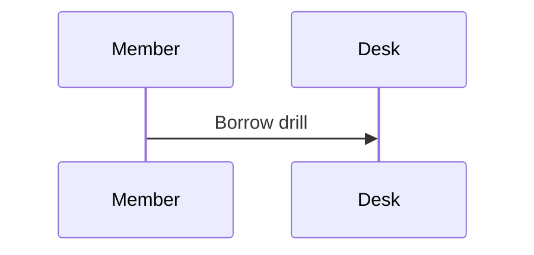

# Member Handbook

Members borrow tools for free. See the [house rules](https://example.org/rules) and the [fee table](#fees) .

### Before You Borrow

- Show your member card

- Check the tool before you leave

- Return tools clean

| Tool | Late fee |
| --- | --- |
| Drill | 1 token \| day |
| Ladder |  |

Floor plan: front room, then workshop.

[Uncopied image: Missing photo](images/missing.png)

[Uncopied image: Odd data](data:image/png,not-base64)

[Mermaid diagram source](diagrams/handbook-mermaid-001.mmd)

